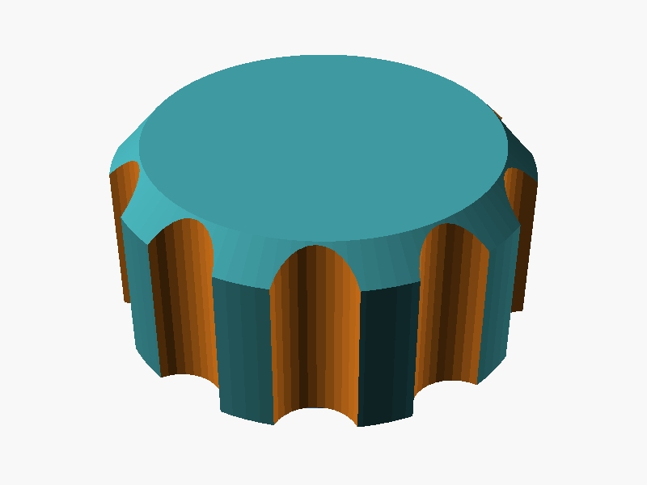
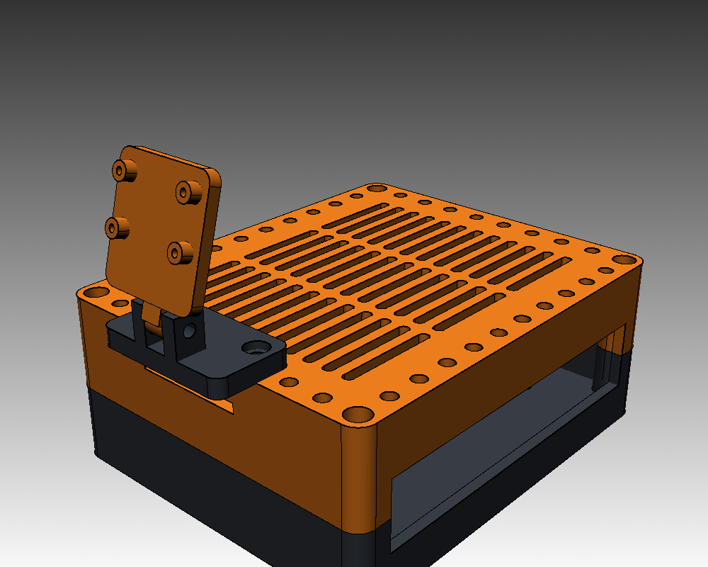

# 3D Models

3D-printable models I designed, mostly parametric [OpenSCAD](https://openscad.org) sources with ready-to-print STLs.

| Model | Preview | Description |
|---|---|---|
| [Twist Lamp](models/twist-lamp/) |  | Twisted vase-mode lamp shade for an LED puck light, with custom name lettering in the base |
| [Camera Mount Knob](models/kamera-knauf/) |  | Clamping knob for an M5 hinge on a phone/camera mount, self-tapping into PETG |
| [ST3215 Robot Arm](models/robot-arm/) |  | 5-DOF desk robot arm with a servo gripper for six Waveshare ST3215 bus servos, printable on an A1 mini |
| [Jetson Nano Case](models/jetson-nano-case/) |  | Modular Jetson Nano case with an M3 insert grid on the floor and top deck, tilting Pi camera mount, the base for a small robot car |

## Layout

```
models/<model-name>/
  README.md   what it is, print settings, parts list
  source/     editable source (.scad, .f3d, .step …)
  stl/        print-ready files
  images/     renders and photos
```

New models start from [`_template/`](_template/).

## License

All models are licensed under [CC BY-NC 4.0](LICENSE): share and remix them freely with credit, but not for commercial use. For commercial licensing, get in touch.
