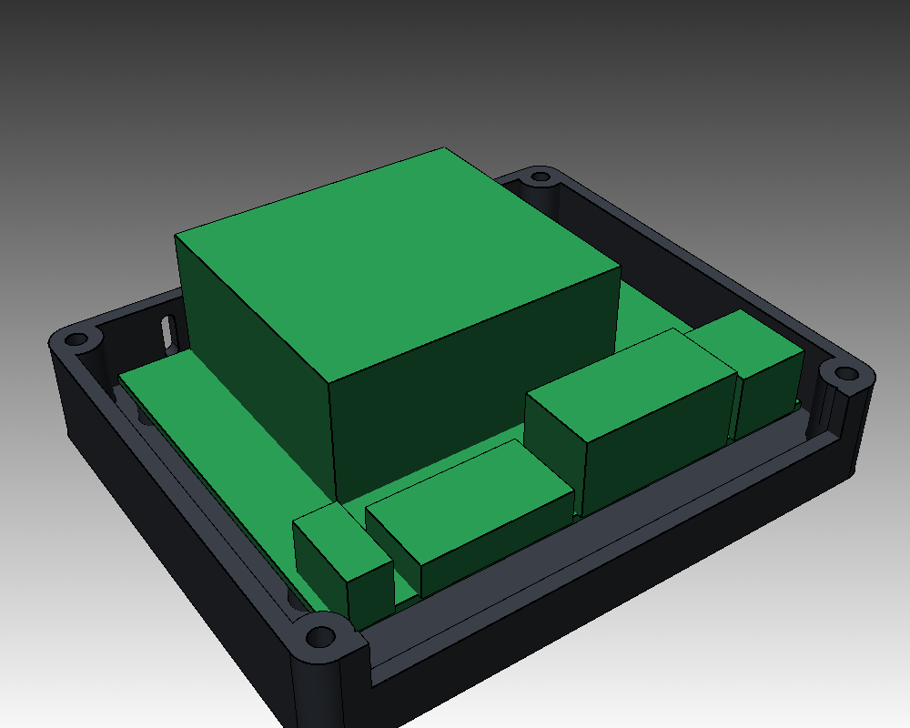
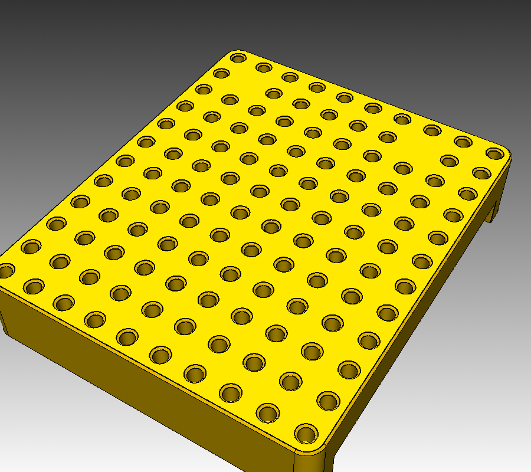

# Jetson Nano Modular Case


A case for the NVIDIA Jetson Nano Developer Kit (carrier P3449 rev A02, also
fits B01) that doubles as the core module of a small robot. The floor and the
top deck both carry M3 heat-set inserts on a **10 mm grid**, so the same case
bolts onto a car chassis, a desk stand or a robot frame, and sensors stack on
top. Every part fits the Bambu Lab A1 mini and is designed for PETG.

| | |
|---|---|
| Outside | 100 × 120 × 48 mm |
| Board | Jetson Nano Dev Kit, 80 × 100 mm, 58 × 86 mm hole pattern |
| Grid | M3 inserts, 10 mm pitch: 118 on the underside, 36 around the top deck |
| I/O | One open window on the +X side: barrel jack, HDMI, DP, 4 × USB, RJ45, micro-USB |
| Extras | 2 × RP-SMA antenna holes, CSI ribbon slot, roof and back-wall vents |
| Camera | Tilting Raspberry Pi Camera v2 mount, −60° to +40° |



## Files

| File | Notes |
|---|---|
| `stl/fit_test.stl` | Print first: frame with the four standoffs. Screw the board on to confirm the hole pattern |
| `stl/base.stl` | Floor with the underside insert grid, board standoffs, lower I/O window, inlet slots |
| `stl/lid.stl` | Exported roof-down for printing. Top deck grid, vents, antenna holes, CSI slot |
| `stl/camera_foot.stl` | Bolts to two deck inserts 30 mm apart, hinge ears |
| `stl/camera_plate.stl` | Exported on its side. Pi Camera v2 standoffs (M2), hinge tongue |

## Hardware

| Qty | Part | Where |
|---:|---|---|
| 4 | M2.5 × 8 screw | Board to standoffs, self-tapping into PETG |
| 4 | M3 × 16 socket head | Lid to base, through the lid corners |
| 4 | M2 × 6 screw | Camera to plate, self-tapping |
| 2 | M3 × 8 socket head | Camera foot to deck |
| 1 | M3 × 16 + nyloc nut | Camera hinge |
| 2 | RP-SMA bulkhead pigtail | WiFi antennas (from your M.2 card kit) |
| 4 + n | ruthex M3 × 5.7 heat-set insert | 4 in the base corner posts, then only the grid points you use |

You don't need to fill the whole grid. Install inserts where a chassis or
accessory actually bolts on. The pockets are Ø 4.0 mm (ruthex datasheet
value). The robot arm uses 4.6 mm; if your inserts end up loose, change
`M3_INSERT_D` in `params.py` and re-export.

## Print settings

- Printer: Bambu Lab A1 mini, 0.4 mm nozzle
- Material: PETG, 240 – 250 °C nozzle, 80 °C bed
- Layer height: 0.2 mm
- Walls: 4 perimeters, 5 top / 5 bottom layers
- Infill: 20 – 25 % gyroid
- Supports: none

| Part | Orientation |
|---|---|
| `base` | As exported, floor on the bed |
| `lid` | As exported, roof on the bed (the CSI slot bridges 32 mm) |
| `camera_foot` | As exported, flat |
| `camera_plate` | As exported, on its side |
| `fit_test` | As exported, flat |

## Assembly

1. Print `fit_test` and screw the board onto it. If the holes don't line up,
   correct `BOARD_HOLES` in `params.py` before printing the big parts.
2. Install 4 inserts in the base corner posts (top side), plus any underside
   grid inserts you need for mounting.
3. Screw the board onto the standoffs with 4 × M2.5 × 8, I/O facing the open
   side.
4. Mount the antenna bulkheads in the lid's back wall. If you use the camera,
   feed the ribbon out through the slot in the −Y wall first.
5. Install inserts in the deck points you plan to use, close the lid with
   4 × M3 × 16.
6. Camera: screw the Pi Camera v2 to the plate (4 × M2), join plate and foot
   with the M3 hinge bolt, and bolt the foot to the two front deck inserts at
   X = ±15, Y = −55. The foot overhangs the front edge so the case stays out of
   the field of view. Tighten the nyloc until the plate holds its angle.



## Notes and limits

- **Board data.** NVIDIA doesn't publish connector coordinates. The hole
  pattern and I/O window come from the STEP files of
  [dudasdavid/Jetson-nano-case](https://github.com/dudasdavid/Jetson-nano-case).
  The window is deliberately one large opening from just below the PCB to
  17.5 mm above it, so a port that sits a millimetre off still clears.
- **Cooling.** The stock passive heatsink gets 30 mm of headroom and the roof
  is slotted. For sustained 10 W mode, a 40 mm fan fits on the heatsink under
  the slots.
- **Weight.** About 190 g of PETG for base + lid at 100 % volume, roughly
  100 – 120 g at the settings above. The 7 mm floor holds the insert pockets
  and makes the base the stiff part of a robot.
- **Interior space.** There is a 7 mm gap between the board and the walls on
  all sides for antenna pigtails and cables.

## Customizing

All dimensions are in `source/params.py`. After changing them:

```
.venv/bin/python models/jetson-nano-case/source/export_all.py   # STLs + bed check
.venv/bin/python models/jetson-nano-case/source/render_all.py   # README images
```

`case.py` builds the base, lid and fit test, `camera.py` the camera mount.
