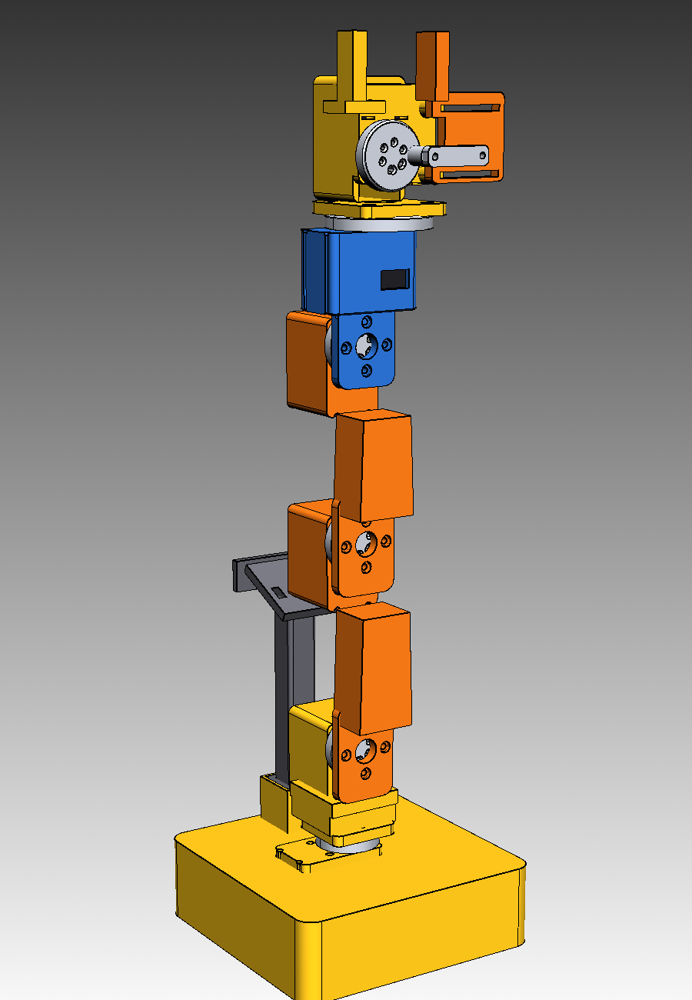
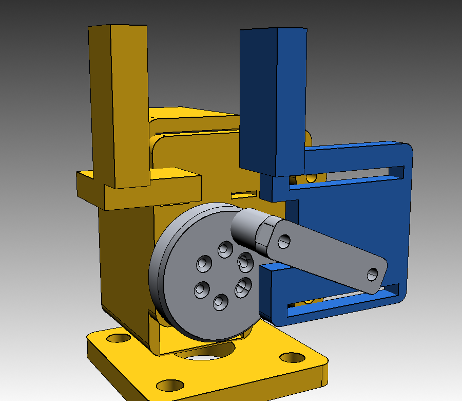

# ST3215 Robot Arm



A 5-DOF desk robot arm with a servo gripper, built around six Waveshare
ST3215 serial-bus servos. Every printed part fits the Bambu Lab A1 mini
(180 × 180 × 180 mm) and is designed for PETG. There are no ball bearings:
each joint is a single-sided servo joint, so the servo's own output bearing
carries the load.

The arm is meant for light vision-guided pick-and-place (table tennis balls,
small blocks) with a Logitech C270 on the mast. A 1 kg load cell + HX711 is
supported as an optional bench-scale accessory, not as part of the wrist.

| | |
|---|---|
| Reach (J2 → tool face) | 297 mm |
| Height (base bottom → gripper top) | ≈ 500 mm |
| Base footprint | 150 × 150 mm |
| Joints | J1 base yaw, J2 shoulder, J3 elbow, J4 wrist pitch, J5 tool roll, J6 gripper |
| Gripper opening | 12 – 40 mm |
| Printed mass | ≈ 600 – 700 g PETG at 25 % infill |



## Files

| File | Notes |
|---|---|
| `stl/base.stl` | Base shell, J1 pocket, electronics bay, camera-mast socket |
| `stl/base_lid.stl` | Removable bottom lid with electronics standoffs |
| `stl/camera_mast.stl` | 138 mm mast with a tilted C270 cradle |
| `stl/turret.stl` | J1 output → J2 axis |
| `stl/upper_arm.stl` | J2 → J3 link, 118 mm |
| `stl/forearm.stl` | J3 → J4 link, 108 mm |
| `stl/wrist.stl` | J4 pitch → J5 roll, 58 mm, roll axis offset 30 mm |
| `stl/horn_adapter.stl` | Standard 36 mm horn adapter, 4 × M3 inserts |
| `stl/tool_adapter.stl` | 56 mm horn adapter for the J5 tool face (M3 at ±18, ±18) |
| `stl/gripper_body.stl` | Gripper frame, fixed jaw, servo housing, guide posts |
| `stl/gripper_jaw.stl` | Moving jaw with guide slots and rod pin |
| `stl/gripper_crank.stl` | Horn adapter with a 14 mm crank pin |
| `stl/gripper_rod.stl` | 30 mm connecting rod |
| `stl/servo_pocket_test.stl` | Fit test: one J-servo pocket, print before the long parts |
| `stl/child_flange.stl` | Optional 36 mm test flange (the links have integrated plates) |
| `stl/robot_arm_assembly.step` | Full assembly for inspection and TCP measurements |

## Bill of materials

### Ordered hardware

| Qty | Part | Used for |
|---:|---|---|
| 6 | Waveshare ST3215 bus servo, 30 kg·cm, 12 V | J1 – J6 |
| 1 | ST3215 serial-bus driver board (USB/UART) | Servo bus + ID setup |
| 2 | Raspberry Pi Pico 2 (pre-soldered headers) | Arm controller + spare |
| 1 | Mean Well 12 V 5 A power supply | Servo rail |
| 1 | Logitech C270 webcam | Vision (USB to the host, not the Pico) |
| 1 | 1 kg load cell + HX711 | Optional scale platform |
| 1 | PETG spool | All printed parts |
| 1 | ruthex M3 × 5.7 heat-set inserts | 30 used, keep spares |
| 1 | M2 / M2.5 / M3 screw assortment | See the screw list |

### Screw list

| Size | Qty | Where |
|---|---:|---|
| M2 × 14 | 24 | 4 per horn adapter, through the adapter into the servo horn |
| M2 × 8 | 24 | 4 per servo pocket / gripper front plate into the servo face |
| M3 × 12 | 20 | 4 per link plate into the adapter inserts |
| M3 × 10 | 4 | Base lid corner screws |
| M3 × 8 | 4 | Lid electronics standoffs |
| M3 × 25 | 2 | Gripper jaw guide screws (through jaw + post + plate + insert) |
| M3 × 10 | 2 | Crank pin and jaw pin |
| M3 × 8 / 10 | as needed | PSU, driver board, spare mounting |

M2.5 screws are not used by this design.

### Inserts

| Location | Qty |
|---|---:|
| Horn adapters (5 × 4) | 20 |
| Base lid corner bosses | 4 |
| Lid electronics standoffs | 4 |
| Gripper jaw guide posts | 2 |
| **Total** | **30** |

Install the inserts with a soldering iron at 230 – 240 °C, straight and
flush. PETG softens early, so use light pressure and let the insert cool
before loading it.

## Print settings

- Printer: Bambu Lab A1 mini, 0.4 mm nozzle
- Material: PETG, 240 – 250 °C nozzle, 80 °C bed
- Layer height: 0.2 mm (0.16 mm for the gripper and adapters if you want detail)
- Walls: 4 perimeters, 5 top / 5 bottom layers
- Infill: 25 – 35 % gyroid or cubic
- Brim: 5 mm on the tall links and the mast
- Supports: only inside the gripper cavity and under the fixed-jaw bridge;
  the servo pockets are oriented to print open-side-up

### Orientation

| Part | Orientation | Supports |
|---|---|---|
| `base` | As exported, open bottom down | tree supports under the top plate; block supports inside the J1 pocket cavity |
| `base_lid` | As exported, flat | none |
| `camera_mast` | As exported, upright (the 25° head is self-supporting) | none |
| `turret` | **Flip 180°**: J2 pocket end cap on the bed, J1 plate up | none |
| `upper_arm`, `forearm` | **Flip 180°**: distal pocket end cap on the bed, proximal plate up | none |
| `wrist` | **Flip 180°**: J5 pocket plate on the bed, J4 plate up | none |
| `gripper_body` | As exported, tool plate on the bed | tree support in the servo cavity and under the fixed-jaw bridge |
| `gripper_jaw` | Lay on its back (Y = 13 face down) | none |
| `gripper_crank` | As exported, spigot on the bed, boss up | none |
| `gripper_rod` | Lay flat on its side | none |
| adapters | As exported, spigot on the bed | none |

The flipped parts put the servo cavity opening at the top; the servo slides
in from that side. The base is printed the right way up and is the one part
that needs a support block under the top plate; pull the supports out through
the open bottom before fitting the lid.

## Assembly

Work from the base up. Set all servo IDs and mid positions **before** the
final assembly (see below).

1. **Base and J1.** Print the base flipped as described. Install the four
   corner inserts in the base bosses. Slide servo 1 into the J1 pocket from
   below (its output faces up through the plate) and fix it with 4 × M2 × 8
   from the top. Bolt the standard horn adapter to the horn with 4 × M2 × 14,
   then the turret to the adapter with 4 × M3 × 12.
2. **J2.** Slide servo 2 into the turret pocket from the rear, output +Y.
   Fit the horn adapter (4 × M2 × 14), then the upper arm (4 × M3 × 12).
3. **J3.** Same sequence in the upper arm's distal pocket: servo 3, adapter,
   forearm.
4. **J4.** Same in the forearm pocket: servo 4, adapter, wrist.
5. **J5.** Slide servo 5 into the wrist pocket from below, output up. Fit the
   56 mm tool adapter (4 × M2 × 14), then the gripper tool plate
   (4 × M3 × 12). The Ø18 hole in the tool plate exposes the four M2 horn
   screws, so the adapter can still be reached later.
6. **J6 / gripper.** Slide servo 6 into the gripper housing from the back,
   output +Y, and fix the front plate with 4 × M2 × 8. Fit the crank adapter
   (4 × M2 × 14). Screw the rod to the crank pin and to the jaw pin with
   2 × M3 × 10. Install the two guide inserts in the front plate, then the
   jaw with the two M3 × 25 guide screws. The jaw must slide freely; back
   the screws out a quarter turn if it binds.
7. **Lid and electronics.** Mount the PSU, driver board and Pico on the lid
   standoffs, connect the bus and 12 V, then close the lid with 4 × M3 × 10.
   The rear cable slot takes the mains and USB cables.
8. **Camera.** Press the mast into the base socket and clip the C270 into the
   tilted cradle. A drop of CA or a wrap of tape around the mast foot takes
   out any wobble.

The wrist's J5 axis is 30 mm in +Y from the J4 axis. The gripper servo
sits 30 mm above the J5 tool face and the grip line is ≈ 75 mm above it
(the pads span Z 58 – 92 in the gripper frame); use the STEP assembly when
you define the tool centre point in software.

## Wiring and firmware

```
12 V 5 A PSU ──► driver board VM / GND
                   │
                   ├── 3-pin bus ── servo 1 ── servo 2 ── ... ── servo 6
                   └── UART ── Pico 2 (TX/RX, common GND)
C270 ── USB ── host PC / Mac (vision)
```

- Add a 470 – 1000 µF electrolytic capacitor across the 12 V rail at the
  driver board. Six servos at stall draw more than 5 A; the supply is sized
  for slow, one- or two-joint moves. If you need faster motion under load,
  use a 10 A supply.
- Daisy-chain the 3-pin servo bus. Keep the signal wire short and twisted;
  run the 12 V and GND as a pair.
- The Pico is the bus master. The C270 is a USB webcam for the host; the Pico
  cannot host it directly. Send joint targets from the host over USB serial,
  or run the vision pipeline on a Raspberry Pi and the Pico as the real-time
  bus bridge.
- Set servo IDs 1 – 6 with the vendor tool before assembly. Use 1 Mbaud if
  your driver supports it, otherwise 115200.
- The second Pico is a spare, or an emergency-stop / HX711 scale controller.

### Calibration

1. Power one servo at a time and confirm the ID.
2. Command the mid position (2048 of 4095) and fit the horn adapter so the
   link is straight in the model pose. The 8 × M2 holes at 45° give a coarse
   clocking; trim the exact zero in firmware.
3. Set soft limits before running the arm: start with ±90° on J2/J3, ±45° on
   J4/J5 and ±60° on J1, then widen only after checking clearances in the
   STEP model.
4. J6: the open pose is the jaw at X = −44 mm, the closed pose at X = −16 mm
   in the gripper frame. The crank rotates 180° between them. Set the servo
   endpoints so the jaw never hits the fixed pad.

## Limits and notes

- **Single-sided joints.** The servo output bearing takes the full moment.
  Keep the payload under ~200 g and avoid long tool extensions.
- **5 A supply.** Fine for slow pick-and-place; not for six joints stalling
  at once.
- **Gripper.** One moving jaw; the fixed pad is the reference surface. Add
  2 mm TPU pads for balls or glossy parts.
- **Camera mast.** The printed post is flexible at full height. For metric
  vision, brace it against a wall or use a tripod; the mast is a convenient
  mounting point, not a metrology fixture.
- **Tool interface.** The J5 tool adapter presents four M3 inserts at
  ±18 mm. The gripper bolts to them; a mallet, suction cup or other end
  effector can be swapped in with the same 4-hole pattern.
- **Load cell.** The 1 kg cell is not part of the arm. A simple platform
  (two printed plates + the cell + HX711 to the Pico) makes a check-weigh
  station for pick-and-place demos.

## Rebuilding

All geometry is CadQuery 2.8 (Python 3.12) in `source/`:

```sh
python3 -m venv .venv && .venv/bin/pip install cadquery==2.8.0
.venv/bin/python models/robot-arm/source/export_all.py   # STLs + bed check
.venv/bin/python models/robot-arm/source/assemble.py     # STEP + hero image
.venv/bin/python models/robot-arm/source/render_gripper.py
```

`params.py` holds the servo envelope, joint stack and arm lengths;
`servo.py` the pocket/adapter family; `links.py`, `base.py` and `gripper.py`
the parts. `export_all.py` asserts every STL fits 180 × 180 × 180 mm.

The ST3215 envelope was taken from the official Waveshare STEP model:
45.22 × 24.72 × 29.0 mm case, 37.25 mm deep with the output cap, output axis
10.11 mm from the short end, 4 × M2 on a 20.7 × 20.5 mm pattern, Ø19.2 horn
with 4 × M2 on a 14 mm bolt circle.
