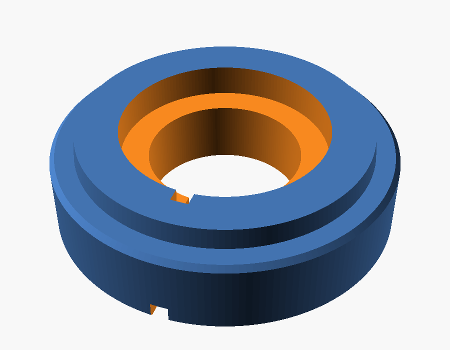
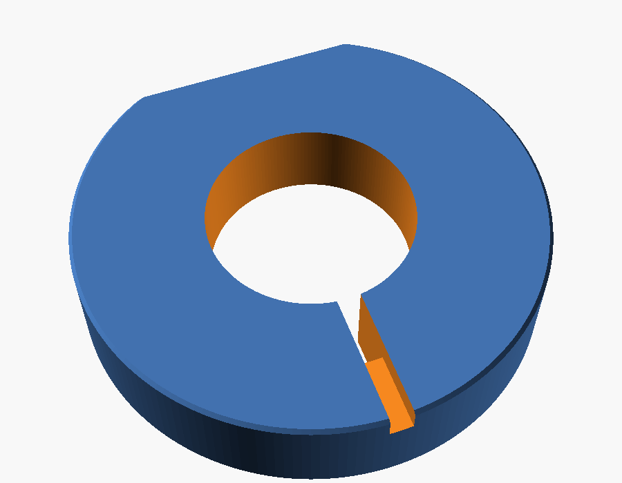
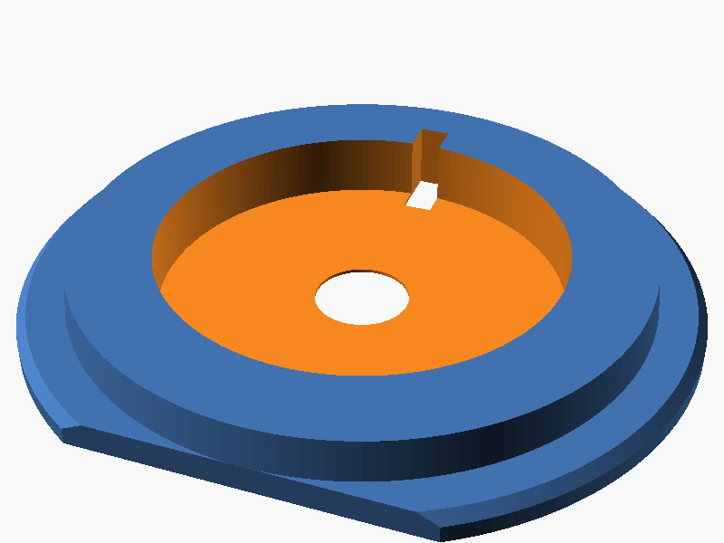

# Twist Lamp


A table lamp for a round LED puck light (MH001, Ø 59.55 mm). The shade has 24 twisted ribs and prints in vase mode. The base has a recessed pocket on the front for raised, two-color name lettering. Every part fits on a Bambu Lab A1 mini (180 × 180 × 180 mm).

## Parts

| File | Color (suggested) | Notes |
|---|---|---|
| `stl/sockel_HELLO.stl` | black | Base with a puck pocket, cable channel and a pocket for the lettering |
| `stl/schirm.stl` | white | Shade, **print in vase mode** (spiral, ~0.6 mm wall) |
| `stl/schriftzug_HELLO.stl` | yellow | Lettering, press or glue it into the base pocket |
| `stl/passtest_sockelring.stl` | any | Optional fit test: top 10 mm of the base, to check puck and shade fit before the full print |

The puck sits on a ledge and can be pushed out from below. The plug and switch pass through the center hole, and the cable leaves through a channel at the back.

## Custom text

The lettering is parametric. Render your own base and lettering:

```sh
openscad -o sockel.stl     -D 'part="sockel"'     -D 'name="ANNA"' source/lampe.scad
openscad -o schriftzug.stl -D 'part="schriftzug"' -D 'name="ANNA"' source/lampe.scad
```

The default font is `Futura:style=Bold`. If you don't have it installed, change `schrift` in `source/lampe.scad`. Measure your own puck too: `puck_h` is an estimate.

## Images

| Base | Base (bottom) | Fit test |
|---|---|---|
|  |  |  |
