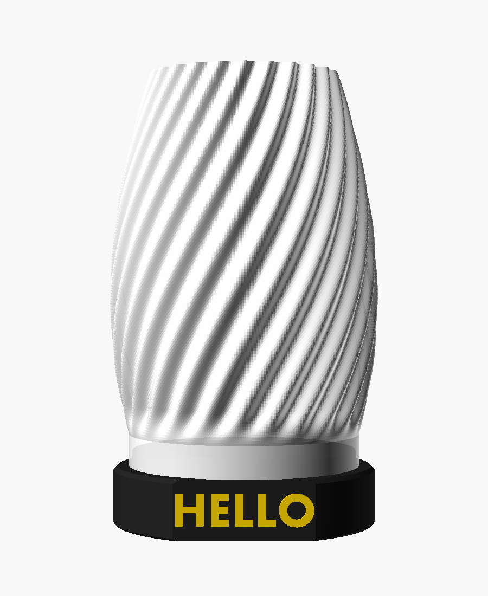
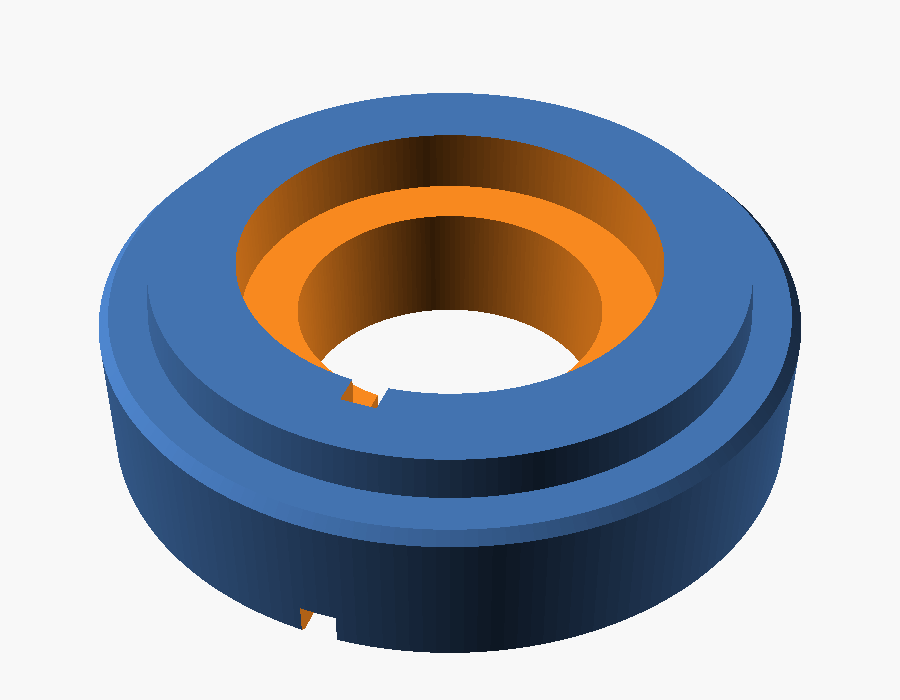
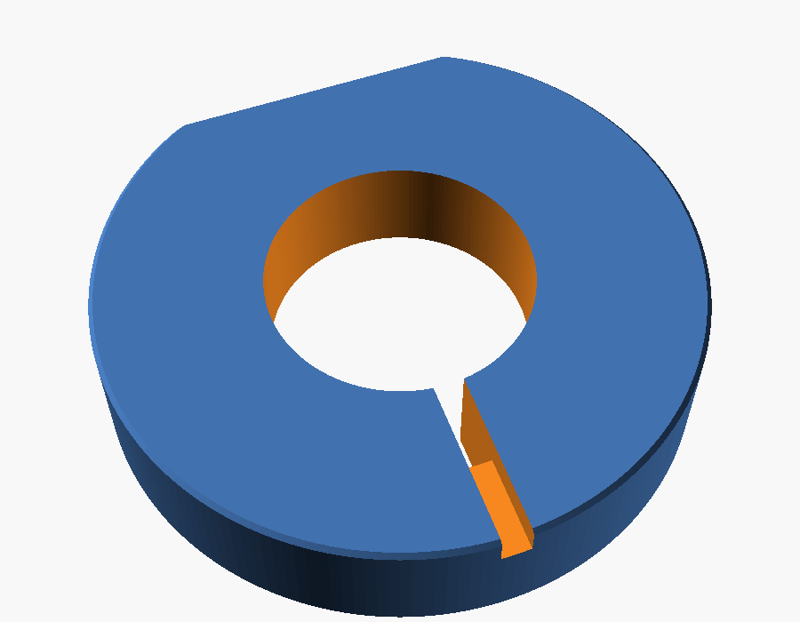
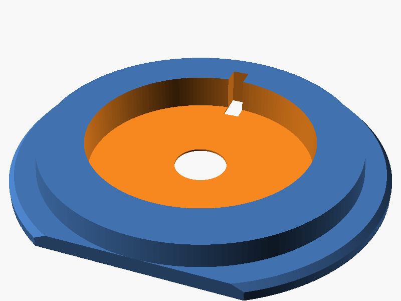

# Twist Lamp



A table lamp for a round LED puck light (MH001, Ø 59.55 mm). The shade has 24 twisted ribs and prints in vase mode. The base has a recessed pocket on the front for raised, two-color name lettering. Every part fits on a Bambu Lab A1 mini (180 × 180 × 180 mm).

## Parts

| File | Color (suggested) | Notes |
|---|---|---|
| `stl/sockel_HELLO.stl` | black | Base with a puck pocket, cable channel and a pocket for the lettering |
| `stl/schirm.stl` | white | Shade, **print in vase mode** (spiral, ~0.6 mm wall) |
| `stl/schriftzug_HELLO.stl` | yellow | Lettering, press or glue it into the base pocket |
| `stl/passtest_sockelring.stl` | any | Optional fit test: top 10 mm of the base, to check puck and shade fit before the full print |

The puck sits on a ledge and can be pushed out from below. The plug and switch pass through the center hole, and the cable leaves through a channel at the back.

## Custom text

The lettering is parametric. Render your own base and lettering:

```sh
openscad -o sockel.stl     -D 'part="sockel"'     -D 'name="ANNA"' source/lampe.scad
openscad -o schriftzug.stl -D 'part="schriftzug"' -D 'name="ANNA"' source/lampe.scad
```

The default font is `Futura:style=Bold`. If you don't have it installed, change `schrift` in `source/lampe.scad`. Measure your own puck too: `puck_h` is an estimate.

## Lithophane shade

`source/lithophane.py` turns a photo into a shade that fits the same base. Dark pixels print thick (3 mm), light pixels thin (0.8 mm), so the photo appears when the lamp is on. The inside is a smooth cylinder that slides over the collar.

```sh
python3 source/lithophane.py photo.jpg -o stl/schirm_lithophane.stl --vorschau vorschau_licht.png
```

- The photo wraps once around the shade: about 273 × 138 mm, so use a ~2:1 photo (a panorama or several photos side by side). It is cropped to fit; `--fit` letterboxes instead.
- Use photos with large faces, clear contrast and a calm background.
- Tune with `--min_dicke`, `--max_dicke` and `--gamma` (below 1 brightens midtones). `--vorschau` saves a rough backlit preview.
- Needs `numpy` and `Pillow`.

**Print:** white PLA, **not** vase mode, 100 % infill (or enough walls to fill it), 0.12 mm layers, upright with a brim. The STL is high-res (~40 MB, ~850k triangles), and the print takes about 10–15 h.

The puck shines up from the bottom, so the top of the photo gets less light than the bottom. Before the full print, cut the STL in the slicer to its lowest ~40 mm as a test ring, and keep important faces in the lower two-thirds.

## Images

| Base | Base (bottom) | Fit test |
|---|---|---|
|  |  |  |
