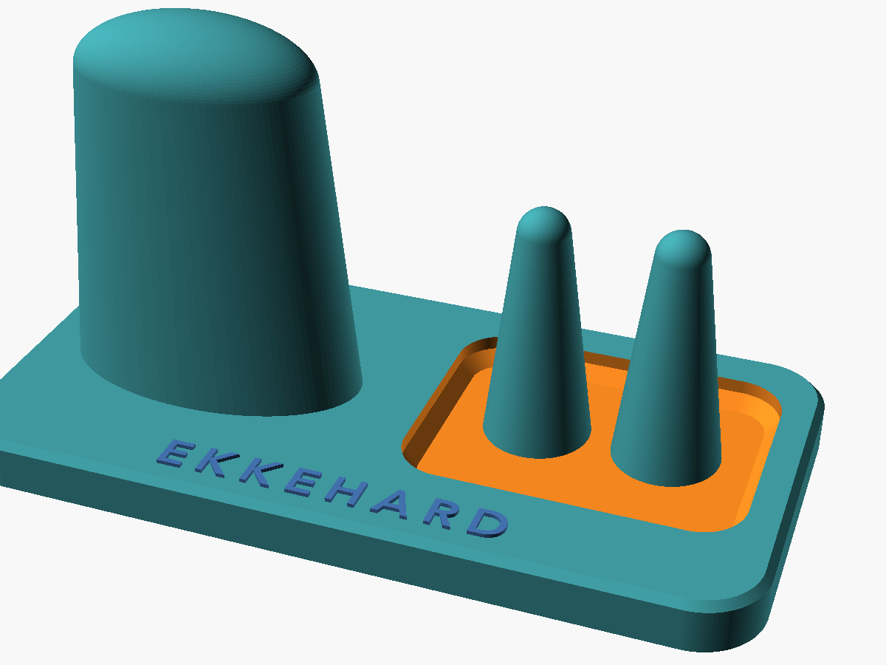
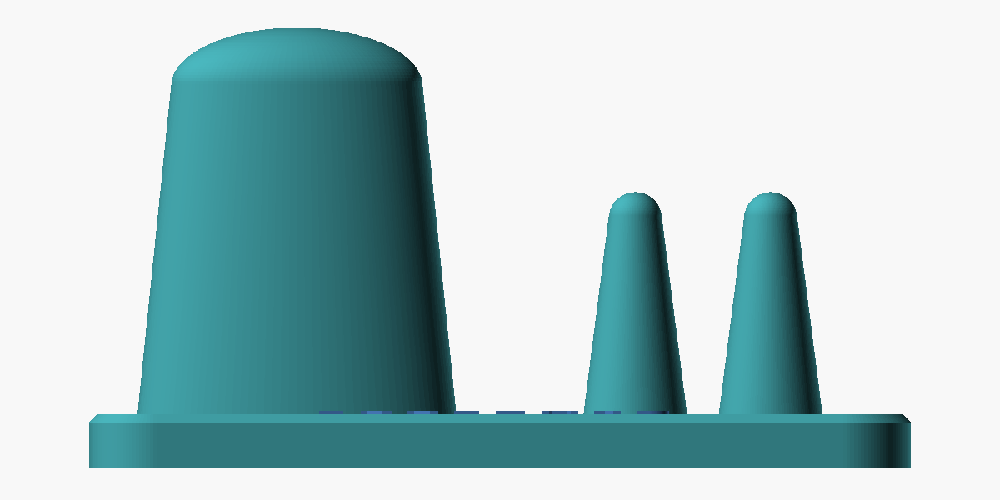

# Watch & Ring Stand



A desk stand for a watch and rings. The watch slides over a tapered oval post (about 164 mm circumference at the bottom, 131 mm at the top), so most watches find their own resting height. Two ring cones sit in a tray that also holds cufflinks or earrings. The name is raised on the front for a two-color print. One piece, no supports, fits on a Bambu Lab A1 mini.

## Parts

| File | Material / color | Notes |
|---|---|---|
| `stl/stand_EKKEHARD.stl` | PLA, e.g. matte black + white or gold | Single part, 170 × 85 × 91 mm |

## Print settings

- Printer: Bambu Lab A1 mini
- Layer height: 0.2 mm
- Walls: 3, infill 10–15 % gyroid
- Supports: none
- **Two colors:** add a filament change (pause) at **Z = 11.2 mm**, the first layer of the raised name. Everything above it is the name, so only the lettering gets the second color.
- Optional: four 10 mm felt pads fit the pockets on the bottom.

## Customizing

All dimensions are parameters at the top of `source/stand.scad`. Render your own name:

```sh
openscad -D 'name="PAPA"' -o stl/stand_PAPA.stl source/stand.scad
```

The default font is `Avenir Next:style=Demi Bold` (built into macOS). Change `font` if you don't have it. For a very large or very small watch, change `post_a_*` / `post_b_*`.

| Front |
|---|
|  |
